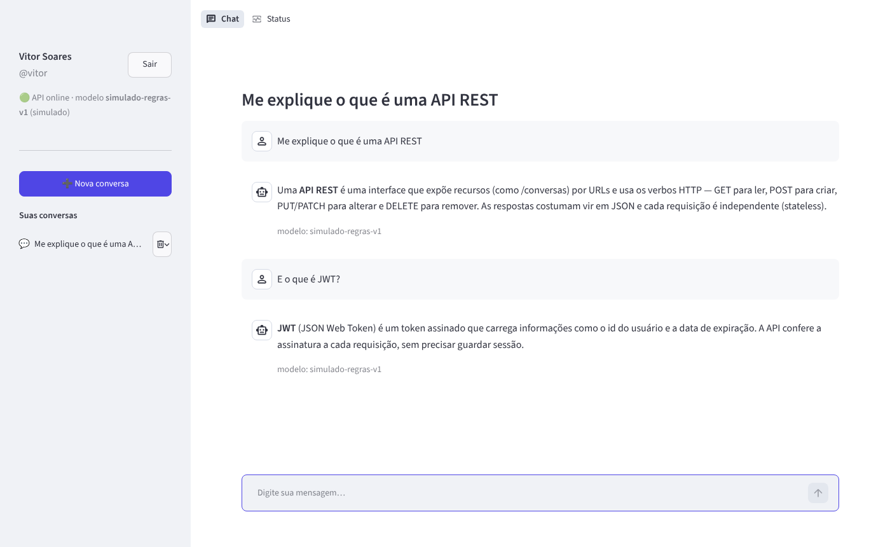
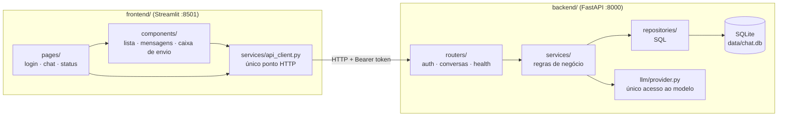
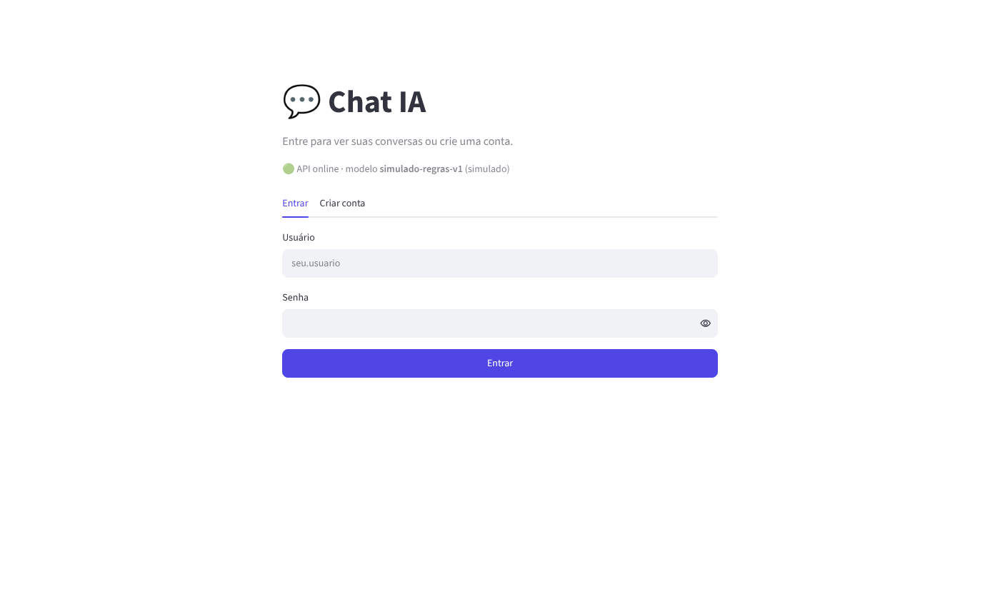
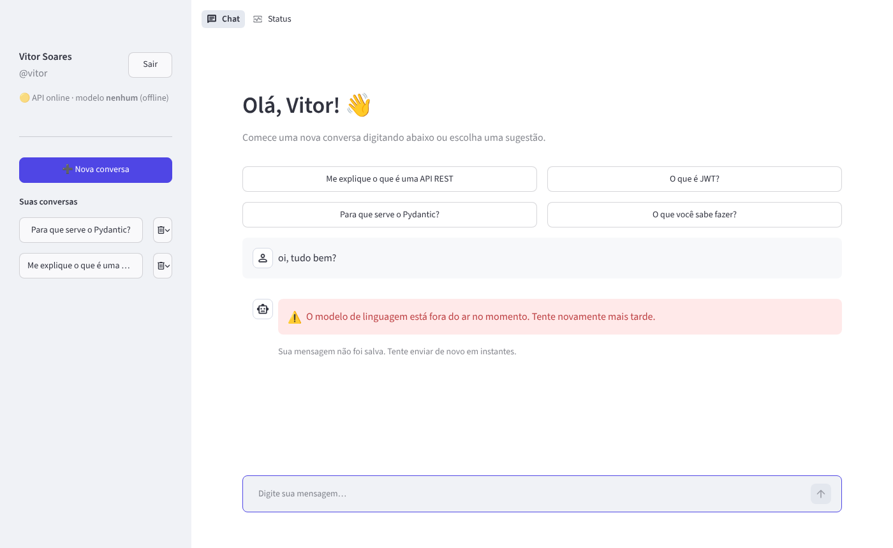
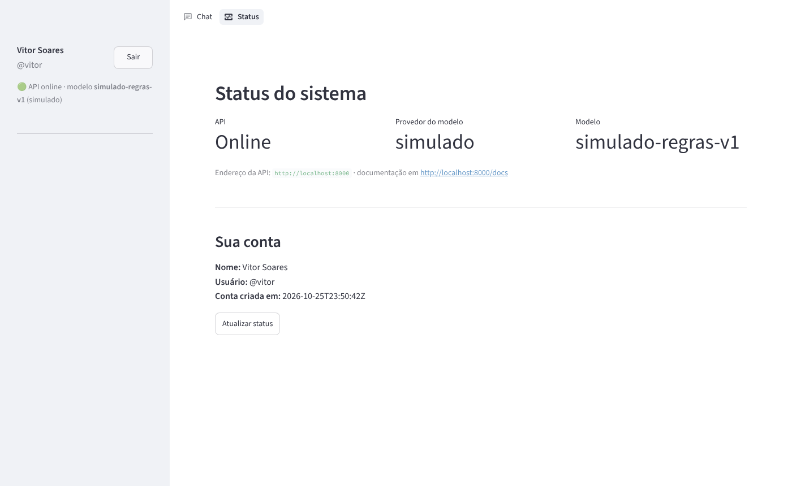

# 💬 Chat de IA Generativa com Múltiplas Conversas

Checkpoint da disciplina **Front-end em Sistemas de IA** — Tecnólogo em Inteligência Artificial (FIAP).

Interface conversacional no estilo dos assistentes de IA generativa: o usuário faz login, vê a lista das suas conversas, abre uma nova, retoma uma antiga e troca mensagens com um bot. O front-end em **Streamlit** conversa exclusivamente, via **requests**, com uma API em **FastAPI** que guarda tudo em **SQLite**.



## 👥 Integrantes

| Nome | RM |
| --- | --- |
| Vitor Soares Gonçalves | RM566181 |
| Arthur Baptista dos Santos | RM565346 |
| João Pedro de Moura Dutra Franco | RM561738 |
| Nelson Felix Neto | RM565603 |
| Pietro Boroto | RM562407 |

---

## 🏗️ Arquitetura

São **dois projetos independentes**, cada um com seu `requirements.txt`, seu `.env` e seu processo:

| Projeto | Tecnologia | Porta | Responsabilidade |
| --- | --- | --- | --- |
| `backend/` | FastAPI + SQLite | **8000** | Autenticação, regras, persistência e acesso ao modelo |
| `frontend/` | Streamlit + requests | **8501** | Telas, estado mínimo e consumo da API |



**Regras que guiaram o desenho**

- O front **nunca importa código do back-end** e **nunca chama o modelo**. Ele só fala HTTP com a API, cuja URL vem de `API_URL` no `.env`.
- Todas as chamadas HTTP do front ficam em **um único módulo**: `frontend/services/api_client.py` (fluxo *páginas → componentes → provider → API*).
- **As conversas vivem no back-end.** O `st.session_state` guarda só `token`, `usuario` e `conversa_ativa_id`; o histórico é lido da API (`GET /conversas/{id}`) a cada execução.
- No back-end, **as rotas não têm regra de negócio**: validam a entrada com Pydantic e delegam ao serviço. O serviço lança exceções de domínio (`ConversaNaoEncontradaError`, `LLMIndisponivelError`…) que o `main.py` converte no código HTTP certo.
- Chaves e configurações ficam no `.env` (fora do Git), com `.env.example` documentado.

### Estrutura de pastas

```
chat-ia/
├── backend/
│   ├── app/
│   │   ├── main.py                 # cria a FastAPI, registra routers e tratadores de erro
│   │   ├── routers/                # health.py, auth.py, conversas.py (APIRouter)
│   │   ├── schemas/                # modelos Pydantic de entrada e saída
│   │   ├── services/               # auth_service, conversa_service, health_service
│   │   ├── repositories/           # usuario, conversa e mensagem (SQL no SQLite)
│   │   ├── llm/provider.py         # único ponto de acesso ao modelo (simulado | gemini | offline)
│   │   └── core/                   # config, security (JWT + bcrypt), database, deps, exceptions
│   ├── tests/                      # 15 testes automatizados (pytest)
│   ├── requirements.txt
│   └── .env.example
├── frontend/
│   ├── app.py                      # entrada + roteamento (st.navigation)
│   ├── pages/                      # login.py, chat.py, status.py
│   ├── components/                 # lista_conversas, mensagens, caixa_envio, boas_vindas, status_api, usuario_sidebar
│   ├── services/api_client.py      # ÚNICO módulo que chama a API
│   ├── core/                       # config (.env), state (sessão mínima), erros (tratamento amigável)
│   ├── .streamlit/config.toml
│   ├── requirements.txt
│   └── .env.example
├── docs/img/                       # capturas de tela
└── README.md
```

---

## 🔌 Endpoints

Documentação interativa completa em **http://localhost:8000/docs** (cada rota tem resumo, descrição e respostas de erro documentadas).

| Funcionalidade | Endpoint | Protegida | Uso no front |
| --- | --- | :---: | --- |
| Saúde da API | `GET /health` | | Indicador "API online · modelo X" |
| Criar conta | `POST /auth/registro` | | Aba "Criar conta" |
| Login | `POST /auth/login` | | Aba "Entrar" → recebe o JWT |
| Usuário logado | `GET /auth/me` | 🔒 | Página Status |
| Listar conversas | `GET /conversas` | 🔒 | Barra lateral |
| Nova conversa | `POST /conversas` | 🔒 | Criada no 1º envio após "Nova conversa" |
| Abrir conversa | `GET /conversas/{id}` | 🔒 | Carrega o histórico no chat |
| Excluir conversa | `DELETE /conversas/{id}` | 🔒 | Ícone de lixeira na barra lateral |
| Enviar mensagem | `POST /conversas/{id}/mensagens` | 🔒 | Caixa de envio |

**Exemplo — `POST /conversas/12/mensagens`** (header `Authorization: Bearer <token>`)

```json
// requisição
{ "conteudo": "Me explique o que é uma API REST" }

// resposta 201
{
  "conversa_id": 12,
  "titulo": "Me explique o que é uma API REST",
  "mensagem_usuario": { "id": 57, "papel": "user", "conteudo": "Me explique o que é uma API REST", "modelo": null, "criado_em": "2026-10-20T14:32:05Z" },
  "resposta": { "id": 58, "papel": "assistant", "conteudo": "Uma API REST é...", "modelo": "simulado-regras-v1", "criado_em": "2026-10-20T14:32:05Z" },
  "modelo": "simulado-regras-v1",
  "criado_em": "2026-10-20T14:32:05Z"
}
```

### Códigos de resposta

| Código | Quando |
| --- | --- |
| `200` / `201` / `204` | Sucesso (leitura / criação / exclusão) |
| `401` | Sem token, token inválido/expirado, ou login com usuário/senha errados |
| `404` | Conversa inexistente **ou de outro usuário** (não revela que ela existe) |
| `409` | Cadastro com nome de usuário já usado |
| `422` | Requisição inválida (validação do Pydantic) — com campo `detail` legível |
| `503` | Modelo de linguagem indisponível — mensagem amigável e **nada é gravado** |

---

## 🔐 Autenticação e autorização

- **Senhas** são guardadas apenas como **hash bcrypt** (nunca em texto puro, nunca devolvidas pela API).
- O login devolve um **JWT** (HS256) com o id do usuário e expiração (`JWT_EXPIRA_MINUTOS`). A chave fica em `JWT_SECRET` no `.env`.
- As rotas protegidas exigem `Authorization: Bearer <token>`, validado pela dependência `get_usuario_atual` (`core/deps.py`).
- **Autorização:** todas as consultas de conversas filtram por `usuario_id` no repositório. Um usuário nunca lista, abre, envia mensagem ou exclui conversa de outro — recebe `404`.
- No front, um `401` limpa a sessão e leva de volta ao login com o aviso "Sessão expirada".

## 🤖 Modelo de linguagem

O acesso ao modelo fica **isolado em `backend/app/llm/provider.py`**. Trocar de modelo é só mudar `LLM_PROVIDER` no `.env` — rotas e front não mudam.

| `LLM_PROVIDER` | O que faz | Precisa de chave? |
| --- | --- | :---: |
| `simulado` **(padrão, usado na entrega)** | Respostas por regras: saudações, glossário (API REST, FastAPI, JWT, Pydantic, Streamlit, SQLite, token) e eco | Não |
| `gemini` | API gratuita do Google Gemini (envia as últimas 20 mensagens como contexto) | Sim |
| `offline` | Sempre indisponível — serve para demonstrar o tratamento do **503** | Não |

**Escolhemos o modo simulado como padrão** porque o foco do checkpoint é a engenharia em volta do bot, e assim o projeto roda em qualquer máquina sem internet nem chave.

**Usando o Gemini (opcional):** gere uma chave gratuita em <https://aistudio.google.com/apikey> e no `backend/.env` defina `LLM_PROVIDER=gemini` e `GEMINI_API_KEY=sua-chave` (modelo em `GEMINI_MODEL`, padrão `gemini-2.5-flash`).
**Limites de uso:** a camada gratuita do Gemini tem limite de requisições por minuto e por dia, que varia por modelo (veja os valores atuais em <https://ai.google.dev/gemini-api/docs/rate-limits>). Quando o limite estoura (HTTP 429) ou a chave falta, a API responde **503** com uma mensagem que o front mostra ao usuário.

---

## ▶️ Como rodar localmente (do zero)

**Pré-requisitos:** Python **3.10+** e Git.

### 1. Clonar

```bash
git clone https://github.com/swagsoares/chat-ia.git
cd chat-ia
```

### 2. Back-end (terminal 1)

```bash
cd backend
python -m venv .venv

# Windows
.venv\Scripts\activate
# Linux / macOS
source .venv/bin/activate

pip install -r requirements.txt

# Windows:  copy .env.example .env
# Linux/macOS:
cp .env.example .env

uvicorn app.main:app --reload --port 8000
```

A API sobe em http://localhost:8000 — teste em http://localhost:8000/health e http://localhost:8000/docs.
O banco `backend/data/chat.db` é criado automaticamente na primeira execução.

### 3. Front-end (terminal 2)

```bash
cd frontend
python -m venv .venv

# Windows
.venv\Scripts\activate
# Linux / macOS
source .venv/bin/activate

pip install -r requirements.txt

# Windows:  copy .env.example .env
# Linux/macOS:
cp .env.example .env

streamlit run app.py
```

Abra http://localhost:8501, clique em **Criar conta** e comece a conversar.

### 4. Testes automatizados (opcional)

```bash
cd backend
pytest -v
```

Os 15 testes usam um banco temporário e cobrem: login e hash de senha, `401` sem token, `404`, `422`, `503` sem gravar nada, isolamento entre usuários, exclusão, persistência após reinício e o provider do Gemini (com resposta simulada).

### Pacotes usados

| Back-end | Front-end |
| --- | --- |
| `fastapi`, `uvicorn[standard]`, `pydantic`, `PyJWT`, `bcrypt`, `python-dotenv`, `requests` (+ `pytest`, `httpx` para testes) | `streamlit`, `requests`, `python-dotenv` |

---

## 🖥️ Front-end

- **Roteamento:** `app.py` usa `st.navigation` — sem login só existe a página *Entrar*; logado aparecem *Chat* e *Status*.
- **Componentização:** cada parte da tela é uma função em `components/` (lista de conversas, mensagens, caixa de envio, boas-vindas, status da API, cartão do usuário).
- **Estado mínimo:** `core/state.py` guarda só `token`, `usuario` e `conversa_ativa_id`.
- **Cliente único:** `services/api_client.py` concentra todas as requisições, com **timeout** (`API_TIMEOUT`) e tradução de erros em mensagens amigáveis — API fora do ar, `401`, `404`, `422`, `503` — sem traceback na tela.
- **Nova conversa:** o botão abre uma tela em branco; a conversa é criada na API no primeiro envio e recebe a primeira mensagem como título.

| Login | Modelo indisponível (503) | Status |
| --- | --- | --- |
|  |  |  |

## 🎥 Vídeo

_Link do vídeo de demonstração:_ **(adicionar aqui)**
